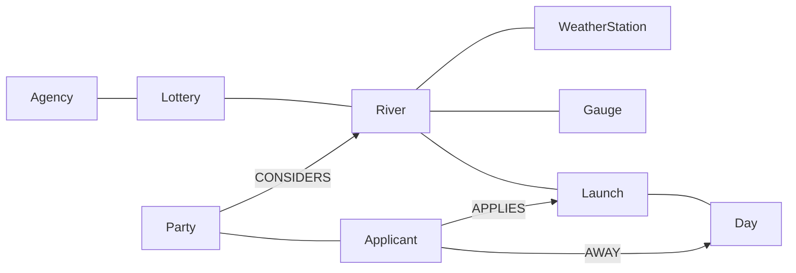

# graph

What's known about each river's lottery, and each party's plan. Ingest and the service write it; `rivers`, `launches` and `plan` read it. How the page shows it is in [ui/README.md](../ui/README.md).

## Two halves

| | Public | Party |
|---|---|---|
| Written by | ingest | the service, as a party edits |
| Traces to | a `source_url` on every node | the party's key |
| Read by | `rivers`, `launches`, `plan` | requests carrying the key |

## Nodes



| Node | Key | Holds |
|---|---|---|
| Lottery | `ridb_id`, `year` | choices per application, whether the holder must be on the trip, per-person limits |
| River | `name` | trip length range, point, flow cutoffs |
| Agency | `name` | |
| Day | `date` | `weekday` |
| Launch | `river`, `date` | odds, expected applications and permits, interval, `flow_years`, `temperature_years`, `freezing_years`, `bugs` |
| Gauge, WeatherStation | source ID | |
| Party | key hash | preferences, `minimum`, `created`, `edited`, `ip_hash` for its first 7 days |
| Applicant | party, `name` | |

| Relationship | Means |
|---|---|
| `(River)-[:IN]->(Lottery)` | Gates of Lodore and the Yampa share lottery 250014 |
| `(Lottery)-[:RUN_BY]->(Agency)` | |
| `(Launch)-[:OF]->(River)`, `(Launch)-[:ON]->(Day)` | a launch is a river on a day |
| `(Party)-[:CONSIDERS {days, preferences}]->(River)` | a river the party is considering, its trip length, and any preferences that differ from the party's |
| `(Applicant)-[:IN]->(Party)` | |
| `(Applicant)-[:AWAY]->(Day)` | a day marked off |
| `(Applicant)-[:APPLIES {choice, applied}]->(Launch)` | the plan; `applied` once the applicant has submitted it |

Weekday is a property of Day, not a node: it's fixed by the date, and nothing attaches to a weekday that doesn't attach to its days. Days marked off are stored rather than free days, because there are fewer of them.

## Conditions

Flow and temperature are ordinal scales. Each launch stores its category for every past year, so a summary or a match can be computed for any preference without another query.

### Flow

| Step | Category |
|---|---|
| 0 | not running |
| 1 | extra low |
| 2 | low |
| 3 | normal |
| 4 | high |
| 5 | spicy high |
| 6 | extra spicy high |

- Each river's cutoffs are flows in cfs at its gauge. They are hand-curated, with a `source_url`, like the bug seasons.
- A past launch's category comes from the gauge's flow on the launch day.
- `flow_years` lists the launch's category in each of `config.FLOW_YEARS`.

| Summary | Is |
|---|---|
| `flow_typical` | the median category over the years |
| `flow_runnable_frequency` | the share of years at low or above |
| `flow_good_frequency` | the share of years at normal or above |

### Temperature

| Step | Category | Daily high, °F |
|---|---|---|
| 0 | cold | under 60 |
| 1 | cool | 60–69 |
| 2 | mild | 70–79 |
| 3 | warm | 80–89 |
| 4 | hot | 90–99 |
| 5 | extra hot | 100 and over |

- A past trip's category comes from the mean of the daily highs over the trip, at the nearest station.
- `temperature_years` lists that category for each year. `freezing_years` lists whether the trip had a night under 32°F.

| Summary | Is |
|---|---|
| `temperature_typical` | the median category over the years |
| `cold_frequency` | the share of years with a night under 32°F |
| `heat_frequency` | the share of years with a high of 100°F or more |

### Bugs

`bugs` is true when the trip overlaps the river's hand-curated bug season.

### Matching preferences

Preferences are a range on each scale, plus whether to avoid bugs. The chance m that a launch matches is the share of past years in which flow and temperature were both inside their ranges. m is 0 for a launch in bug season when bugs are avoided. Counting flow and temperature together, year by year, keeps their correlation: hot years melt out early.

The party sets one value for each preference. Any preference a river changes is stored on that river's CONSIDERS relationship and replaces the party's value for that river only.

## Keys

- Four words from the EFF long wordlist, e.g. `otter-canyon-cobble-ferry`: 7,776⁴ ≈ 3.7 × 10¹⁵ keys.
- The page's URL is `/p/{key}`. Anyone with the link can edit the plan. No accounts, no passwords.
- The graph stores `HMAC-SHA256(key, server secret)`, never the key, so a copy of the database opens no party.
- One function reads and writes a party, and it takes the key. No other query matches Party or Applicant. No request carries Cypher.
- At most 3 new parties a week from one IP. A new Party holds `ip_hash`, `HMAC-SHA256(IP, server secret)`. The limit counts the parties with that hash created in the last 7 days, and `ip_hash` is removed once its party is 7 days old. A week is too long to count in memory, because a restart or deploy would reset the count.

## Odds stay in

- `data/` isn't in git. Fitted odds reach the service only through the graph.
- Launch odds, applications, permits and intervals live in the graph. No function returns them as they're stored.
- `plan` returns the party's odds of at least one permit and each application's odds, to the whole percent.
- `launches` returns dates and conditions, not odds.
- 60 `plan` calls a minute per key.

A party can still estimate a launch's odds by planning only that launch. These rules stop someone copying the whole table, not one curious party.

## Other parties

A launch's odds for a party count the other parties' applications for it:

p′ = permits / (applications + n)

where n is the number of other parties' applications for that launch marked applied. An application counts from the moment it's marked applied, so a plan that's still being edited doesn't move anyone else's odds, and abandoned plans count for nothing. A party's own applications are never in n. Other parties' applications aren't in the forecast, because it was fitted on years before max-float existed. On the Middle Fork, May 29, 2027 is expected to draw 54 applications for 12.74 permits, so 23.6%. With 10 applications from other parties it's 19.9%. Popular launches barely change. Launches with few applications, which is where the planner sends people, change the most.

Only counts reach a party. Nothing shows which party applied.

## Plan as a flow

`plan` builds a flow network in memory from the graph for each call. The network isn't stored.

```
source → application → launch → sink
```

| Edge | Exists when | Capacity | Cost |
|---|---|---|---|
| source → application | an application is one applicant in one lottery | lottery's choices per application | 0 |
| application → launch | the applicant and at least `minimum` applicants have no AWAY day in the trip | 1 | −log(1 − p′·m) |
| launch → sink | | applications the party may make for one launch | 0 |

m is the chance conditions match the preferences. Costs are scaled to integers for `networkx.max_flow_min_cost`. Every cost is zero or less, so the cheapest maximum flow gives the highest odds. Days and weekdays decide which edges exist. They don't appear in the flow. A node joins the flow only when it carries a capacity or a cost.

Neo4j runs no algorithms: AuraDB Free has no Graph Data Science, and the flow is small enough to solve in Python.

### Minimum

`minimum` is how many applicants must be free for a launch. It starts at the whole party, which gives one plan. Below the whole party, `plan` also gives one plan for each applicant:

| Plan | Maximizes | Cost on a launch |
|---|---|---|
| party | the chance of at least one permit | −log(1 − p′·m) |
| an applicant's | the chance that applicant gets on a trip | −log(1 − p′·m) if the applicant is free for it, else 0 |

Each plan is the same network with different costs. `plan(party, applicant=None)` gives the party's plan, and `plan(party, applicant)` gives that applicant's. The page and the MCP tool both pass the same argument.

## Storage

AuraDB Free allows 200,000 nodes and 400,000 relationships, pauses after 72 hours idle, deletes a database paused for 30 days, and keeps no backups.

| | Nodes | Relationships |
|---|---|---|
| Public, 11 rivers | ~1,500 | ~3,000 |
| One party of 6, 30 days away each | ~7 | ~200 |

That leaves room for about 2,000 parties. Daily flows and temperatures stay in `data/processed/`. They'd fill the graph as nodes, and only each launch's categories by year are needed.

Every night the party half is exported to S3. If the instance is ever deleted, the public half is rebuilt by ingest and the party half is restored from the latest export. Parties are kept until the 2027 results are scored, then deleted.

## Checks

Tests run offline against a fake driver, as in `test_graph.py`. `plan` is tested on plain data without the graph.

## Open questions

- What are each lottery's choices per application and limits per launch? These set the flow's capacities.
- Which years go in `config.FLOW_YEARS`? Dam operations changed on some rivers, so older years may not count.
- Should temperature follow each party's trip length, or the river's usual trip?
- Are weather stations near a river close enough to the canyon floor, or do they need correcting for elevation?
- Should bugs get a scale, or stay in season and out of season?
- Should an applicant be able to mark an application won, so plans can be scored after the draw?
