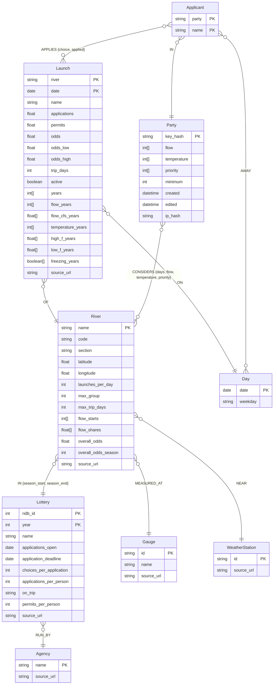

# graph

What's known about each river's lottery, and each party's plan. Ingest and the service write it; `rivers`, `launches` and `plan` read it. How the page shows it is in [ui/README.md](../ui/README.md).

## Two halves

| | Public | Party |
|---|---|---|
| Written by | ingest | the service, as a party edits |
| Traces to | a `source_url` on every node but Day, which holds only a date | the party's key |
| Read by | `rivers`, `launches`, `plan` | requests carrying the key |

## Schema

`PK` marks a node's key. The public half is written by [load.py](load.py). The party half is the design for the service, and nothing writes it yet.



| Node | What its properties mean |
|---|---|
| Lottery | One draw, with the rules in `config.LOTTERY_RULES` that apply to all of its rivers. A blank rule is one no source states |
| River | Its `code`, three letters from `config.RIVER_CODES`, rules that differ by river, its point, and its flow categories: `flow_starts` is where each category after "not running" starts in cfs, and `flow_shares` is each category's share of lottery-season days. `overall_odds` is its overall odds in `overall_odds_season` |
| Agency, Gauge, WeatherStation | Where a river's lottery and conditions come from. `id` is the USGS site number or NOAA station ID |
| Day | A date and its weekday |
| Launch | A river on a date: its expected `applications` and `permits`, its `odds` and their interval, and its conditions by year. See [Conditions](#conditions). `name` is its river's code and date, which the Neo4j console shows as its caption. `active` is false once it's no longer in the data files |
| Party | The party's preferences, as the votes for each step on each scale and a priority, its `minimum`, when it was `created` and `edited`, and `ip_hash` for its first 7 days |
| Applicant | A person in a party. `party` is the party's `key_hash` |

| Relationship | Properties | Means |
|---|---|---|
| `(River)-[:IN]->(Lottery)` | `season_start`, `season_end` | the lottery covers the river, with its first and last launch dates that year. Gates of Lodore and the Yampa share lottery 250014 |
| `(Lottery)-[:RUN_BY]->(Agency)` | | |
| `(River)-[:MEASURED_AT]->(Gauge)` | | where the river's flow is measured |
| `(River)-[:NEAR]->(WeatherStation)` | | where the river's highs and lows are measured |
| `(Launch)-[:OF]->(River)`, `(Launch)-[:ON]->(Day)` | | a launch is a river on a day |
| `(Party)-[:CONSIDERS]->(River)` | `days`, `flow`, `temperature`, `priority` | a river the party is considering, its trip length, and any preferences that differ from the party's |
| `(Applicant)-[:IN]->(Party)` | | |
| `(Applicant)-[:AWAY]->(Day)` | | a day marked off |
| `(Applicant)-[:APPLIES]->(Launch)` | `choice`, `applied` | the plan; `applied` once the applicant has submitted it |

Weekday is a property of Day, not a node: it's fixed by the date, and nothing attaches to a weekday that doesn't attach to its days. Days marked off are stored rather than free days, because there are fewer of them.

## Conditions

Flow and temperature are ordinal scales. Each launch stores its category for every past year, so a summary or a match can be computed for any preference without another query.

### Flow

| Step | Category |
|---|---|
| 0 | not running |
| 1 | extra low |
| 2 | low |
| 3 | normal |
| 4 | high |
| 5 | spicy high |
| 6 | extra spicy high |

- Each river's cutoffs are flows in cfs at its gauge, in `config.FLOWS`, and its gauge is in `config.GAUGES`. `rivers.csv` has each category's range and share of lottery-season days.
- A past launch's category comes from the gauge's flow on the launch day.
- `years` lists the years measured, from `config.FLOW_YEARS`. Every list below is in the same order, so a value's position gives its year.
- `flow_years` lists the launch's step in each of those years, with -1 for a year with no reading. `flow_cfs_years` lists the flow behind each step, in cfs, with NaN for a year with no reading.

| Summary | Is |
|---|---|
| `flow_typical` | the median category over the years |
| `flow_runnable_frequency` | the share of years at low or above |
| `flow_good_frequency` | the share of years at normal or above |

### Temperature

| Step | Category | Daily high, °F |
|---|---|---|
| 0 | cold | under 60 |
| 1 | cool | 60–69 |
| 2 | mild | 70–79 |
| 3 | warm | 80–89 |
| 4 | hot | 90–99 |
| 5 | extra hot | 100 and over |

- A past trip's category comes from the mean of the daily highs over the trip, at the river's station. The trip is the river's `max_trip_days` from the launch day, stored as the launch's `trip_days`.
- `temperature_years` lists that step for each year, with -1 for a year with no reading. `freezing_years` lists whether the trip had a night under 32°F.
- `high_f_years` lists the mean high behind each step, and `low_f_years` the trip's lowest low, both in °F and in the same order, with NaN for a year with no reading.

| Summary | Is |
|---|---|
| `temperature_typical` | the median category over the years |
| `cold_frequency` | the share of years with a night under 32°F |
| `heat_frequency` | the share of years with a high of 100°F or more |

### Matching preferences

Preferences are the votes on each scale, `config.VOTES` each, stored as each step's votes in order, and the priority.

A launch is left out of a party's subgraph when its `flow_typical` or `temperature_typical` has no votes. Typical is the test because a launch's categories vary by year: on the default categories, requiring every past year to have votes would leave the Rio Chama 1 launch and the Salt none, while typical keeps 29 of 30 and 49 of 76.

For a launch that's left, its flow match f is the mean over past years of the votes for that year's flow category, over the most votes any flow category has, and its temperature match t the same for temperature. So a launch that was in the most voted category every year matches fully, and a year with no reading or in a category with no votes counts 0. They're separate so that the priority can weigh them separately, which gives up their correlation year by year: hot years melt out early.

The party sets one value for each preference, and flow's and temperature's values are their votes for each step. Any preference a river changes is stored on that river's CONSIDERS relationship and replaces the party's value for that river only. A launch uses its own river's values.

## Keys

- Four words from the EFF long wordlist, e.g. `otter-canyon-cobble-ferry`: 7,776⁴ ≈ 3.7 × 10¹⁵ keys.
- The page's URL is `/p/{key}`. Anyone with the link can edit the plan. No accounts, no passwords.
- The graph stores `HMAC-SHA256(key, server secret)`, never the key, so a copy of the database opens no party.
- One function reads and writes a party, and it takes the key. No other query matches Party or Applicant. No request carries Cypher.
- At most 3 new parties a week from one IP. A new Party holds `ip_hash`, `HMAC-SHA256(IP, server secret)`. The limit counts the parties with that hash created in the last 7 days, and `ip_hash` is removed once its party is 7 days old. A week is too long to count in memory, because a restart or deploy would reset the count.

## Odds

- `data/` isn't in git. Fitted odds reach the service only through the graph.
- The beta loads ten rivers. The Rogue stays in `config.RIVERS` and the CSVs, and the load skips it until it has permit data.
- `launches` and `plan` return odds, rounded to `config.ODDS_DIGITS` decimal places: 4 by default, a hundredth of a percent.
- Given no river, `launches` returns every river's launches, so the page needs one call.
- Expected applications, permits, intervals and weekday factors stay in the graph.

## Other parties

A launch's odds for a party count the other parties' applications for it:

p′ = permits / (applications + n)

where n is the number of other parties' applications for that launch marked applied. An application counts from the moment it's marked applied, so a plan that's still being edited doesn't move anyone else's odds, and abandoned plans count for nothing. A party's own applications are never in n. Other parties' applications aren't in the forecast, because it was fitted on years before max-float existed. On the Middle Fork, May 29, 2027 is expected to draw 54 applications for 12.74 permits, so 23.6%. With 10 applications from other parties it's 19.9%. Popular launches barely change. Launches with few applications, which is where the planner sends people, change the most.

Only counts reach a party. Nothing shows which party applied.

## Plan as a flow

`plan` builds a flow network in memory from the graph for each call. The network isn't stored.

### A party's subgraph

Nothing a party does changes the public graph. For each call, `subgraph.for_party` reads the active launches of the rivers the party is considering, and builds the party's own subgraph in memory: the launches its applicants and preferences leave, each with its flow and temperature matches, its river's priority and the applicants free for it. The flow is built from that subgraph, and both are gone when the call ends.

So "left out" and "widened" only ever apply to one party's subgraph. Two parties with different preferences read the same launches, and a launch one leaves out stays available to the other.

### The network

```
source → application → launch → river → sink
```

| Edge | Exists when | Capacity | Cost |
|---|---|---|---|
| source → application | an application is one applicant in one lottery | lottery's choices per application | 0 |
| application → launch | the applicant and at least `minimum` applicants have no AWAY day in the trip, and the launch is in the party's subgraph | 1 | log(1 − p′·f^a·t^b) |
| launch → river | | applications the party may make for one launch | 0 |
| river → sink | | the river's share of the plan: unlimited in the first solve, fixed in the second | 0 |

f and t are the launch's flow and temperature matches, and a and b come from the priority. Costs are scaled to integers for `networkx.max_flow_min_cost`. Every cost is zero or less, so the cheapest maximum flow gives the highest odds at that priority. Launches left out of the subgraph have no edge rather than a high cost, because a maximum flow would still use a costly edge to fill spare choices. Days and weekdays decide which edges exist. They don't appear in the flow. A node joins the flow only when it carries a capacity or a cost.

Neo4j runs no algorithms: AuraDB Free has no Graph Data Science, and the flow is small enough to solve in Python.

### Priority

`priority` splits `config.SLICES`, 12, between odds, flow and temperature, and starts at 4 each. A launch's score at its river's priority is p^(O/12)·f^(F/12)·t^(T/12), where O, F and T are the slices for odds, flow and temperature. Launches are ranked by score, then odds, then date.

With slices on odds, ranking by score is ranking by p·f^a·t^b, where a = F/O and b = T/O, which is what the flow's costs use. At 4 each that's p·f·t, so the plan maximizes the chance of at least one permit in matching conditions, 1 − ∏(1 − p′·f·t). Other splits give up some of that chance to lean toward odds, flow or temperature. With no slices on odds, the flow's costs are log(1 − f^F·t^T), and odds only break ties.

`plan` also returns `odds`: the odds of at least one permit, 1 − ∏(1 − p), with the recommended launches, with as many of each river's most common launches, those with the most applications, and the mean over every way to pick as many at random. The first row is for all rivers, with each river's chance combined as if every river's draw were independent, and then one row for each river with launches recommended. Rivers sharing a lottery each count on their own. In a simulated draw where each application gets its first choice with a permit left, 1 − ∏(1 − p) came out slightly low, with p as permits over the applications listing a launch.

### A river's share

A river's own priority changes which launches it gets, never how many. Weighting one river's launches differently would otherwise move applications to other rivers, so `plan` solves the flow twice:

1. Every river at the party's priority. The number of applications each river gets is its share.
2. Each river at its own priority, with river → sink capped at its share.

The first solve's flow fits inside the second's capacities, so the second places the same total and fills every share exactly. The party's priority and a river's votes can still change the shares, because they change the launches every river competes with.

### Widened rivers

A river is widened when it has launches the party is free for, but its voted categories drop them all. Each of those launches is scored by the steps from its `flow_typical` and `temperature_typical` to the nearest voted categories, added together. The launches with the lowest score decide: their typical categories, and any between those and the voted ones, are added for that river, with one vote each.

This happens before the first solve, so a widened river competes for its share like any other. The added categories count in the matches. They aren't stored: `plan` works them out on each call and returns each widened river with the categories added, so the page, the API and the MCP tools all report the same warning. A river with no free launches isn't widened, and `plan` returns the reason instead. A river that keeps its launches but gets no applications isn't widened.

With votes only for normal or better flow and mild or warmer temperature, the Salt has no launches left. Widening adds low flow, which leaves 34.

### Minimum

`minimum` is how many applicants must be free for a launch. It starts at the whole party, which gives one plan. Below the whole party, `plan` also gives one plan for each applicant:

| Plan | Maximizes at 4 slices each | Cost on a launch |
|---|---|---|
| party | the chance of at least one permit | log(1 − p′·f^a·t^b) |
| an applicant's | the chance that applicant gets on a trip | log(1 − p′·f^a·t^b) if the applicant is free for it, else 0 |

Each plan is the same network with different costs. `plan(party, applicant=None)` gives the party's plan, and `plan(party, applicant)` gives that applicant's. The page and the MCP tool both pass the same argument.

## Loading

```bash
uv run python -m max_float.graph        # check the connection
uv run python -m max_float.graph.load   # load the public half and print the counts
```

Build `rivers.csv`, `odds.csv` and `conditions.csv` first. See [ingest/README.md](../ingest/README.md).

| Function | Does |
|---|---|
| `graph.neo4j_config()` | Finds Neo4j's URI, username and password in the environment, `config.NEO4J_CREDENTIALS` or AWS |
| `graph.driver()` | Opens a driver for that instance |
| `graph.check()` | Signs in, and returns the server's address and version |
| `load.load()` | Reads the data files, makes the constraints, writes everything in one transaction, and returns `counts` |
| `load.tables(rivers, odds, conditions)` | Turns the data files' rows into the rows for each statement. Needs no database |
| `load.past_trips(launch, days, trip_days)` | Works out a launch's `flow_years`, `temperature_years` and `freezing_years` |
| `load.write(tx, rows)` | Runs each statement in `load.STATEMENTS` with its rows |
| `load.counts(session)` | Counts the nodes and relationships of each kind |
| `subgraph.for_party(session, party)` | Builds a party's subgraph from the public graph, without writing to it |
| `subgraph.subgraph(party, launches)` | Applies a party's preferences, days away and `minimum` to launches, and widens any river left empty. Needs no database |
| `subgraph.read(session, rivers)` | Reads the active launches of some rivers, with their codes and lotteries |

- Loading again updates what's there: every statement merges on a node's key, and a failed load changes nothing.
- Nothing is deleted. A launch that's no longer in the data files stays in the graph with `active` false, keeping any party's applications for it, and subgraphs don't read it.
- A river is loaded only if it has odds, which leaves out the Rogue until it has permit data.

## Storage

AuraDB Free allows 200,000 nodes and 400,000 relationships, pauses after 72 hours idle, deletes a database paused for 30 days, and keeps no backups.

| | Nodes | Relationships |
|---|---|---|
| Public, 10 rivers | 1,143 | 1,815 |
| One party of 6, 30 days away each | ~7 | ~200 |

That leaves room for about 2,000 parties. Daily flows and temperatures stay in `data/conditions.csv`. They'd fill the graph as nodes, and each launch only needs its categories and readings by year.

Every night the party half is exported to S3. If the instance is ever deleted, the public half is rebuilt by ingest and the party half is restored from the latest export. Parties are kept until the 2027 results are scored, then deleted. The instance has to stay awake through the beta, as a pause would take every party's plan offline.

## Checks

Tests run offline against a fake driver, as in `test_graph.py`. `plan` is tested on plain data without the graph, including that changing one river's priority never changes any river's share, and that widening adds only the nearest categories.

## Open questions

- What are the San Juan's and Rio Chama's choices per application, and each lottery's limits per launch? These set the flow's capacities. What's known is in `config.LOTTERY_RULES`.
- Which years go in `config.FLOW_YEARS`? Dam operations changed on some rivers, so older years may not count.
- Should temperature follow each party's trip length, rather than each river's `max_trip_days` as it does now?
- Are weather stations near a river close enough to the canyon floor, or do they need correcting for elevation?
- Should an applicant be able to mark an application won, so plans can be scored after the draw?
